## Tuatara

A text editor for the terminal and the desktop, written in Common Lisp after
the ideas of Emacs, made to open files from anywhere safely.

| **Opens anything safely** | **Files of any size** | **Git, after Magit** |
|---|---|---|
| Nothing in a file is ever run; evidence opens read-only, its access time kept. | Gigabytes open at once; millions of cursors, saves in the background. | Stage the lines you select; a file or a folder as any commit left it. |
| **Org, its own** | **Code** | **Yours to change** |
| Folding, tables, agenda, capture, export to PDF and Word, no Emacs needed. | Close to 300 languages by tree-sitter, language servers, a Lisp REPL. | Everything but a small core is Lisp; the source of anything one key away. |

### Try it: version 0.90.1, testers wanted

The [releases](https://github.com/Tuatara-Editor/tuatara/releases) have an
AppImage that runs on Linux with nothing installed, and packages for
Fedora, Ubuntu and Arch:

```
chmod +x Tuatara-x86_64.AppImage
./Tuatara-x86_64.AppImage FILE          # in this terminal
./Tuatara-x86_64.AppImage --gui FILE    # in a window of its own
```

It works on any file system, and best on one that shares blocks between
files (btrfs, XFS, bcachefs, ZFS): there a copy of a large file takes no time
and no space, and a save shares the blocks of what did not change wherever it
can. `M-x check-health` says which of the programs Tuatara can use are
installed; the [tuatara README](https://github.com/Tuatara-Editor/tuatara#readme)
says what to install beside it.

Something wrong, or an idea? [Open an
issue](https://github.com/Tuatara-Editor/tuatara/issues/new/choose): the
form asks for the version, the system, and the lines of
`~/.cache/tuatara/debug.log` from around the failure. Never attach a file you
are not free to share: a small made-up one that shows the same is enough.

### Files of any size

A file of gigabytes opens at once, its lines counted in the background on
every core. A regular expression is counted as you type; `f` puts a cursor on
every match, here 3,750,098 of them in a 2.1 GB file, and what is typed at
one is written at all, those out of sight in the background. The save runs in
the background too, the editor free meanwhile.

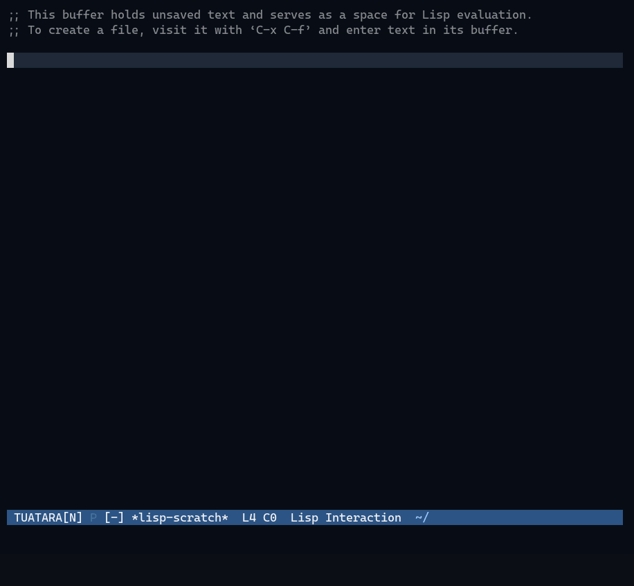

### Editing

DONKEY modal editing on top of the standard Emacs keys (or the Emacs keys
alone): in NORMAL state letters move and select, by word, line, bracket,
paragraph or the syntax. A selection splits into a cursor at every match of a
regular expression, each changed, wrapped or deleted at once; `t` adds a
cursor on the next line; one `u` undoes it all.

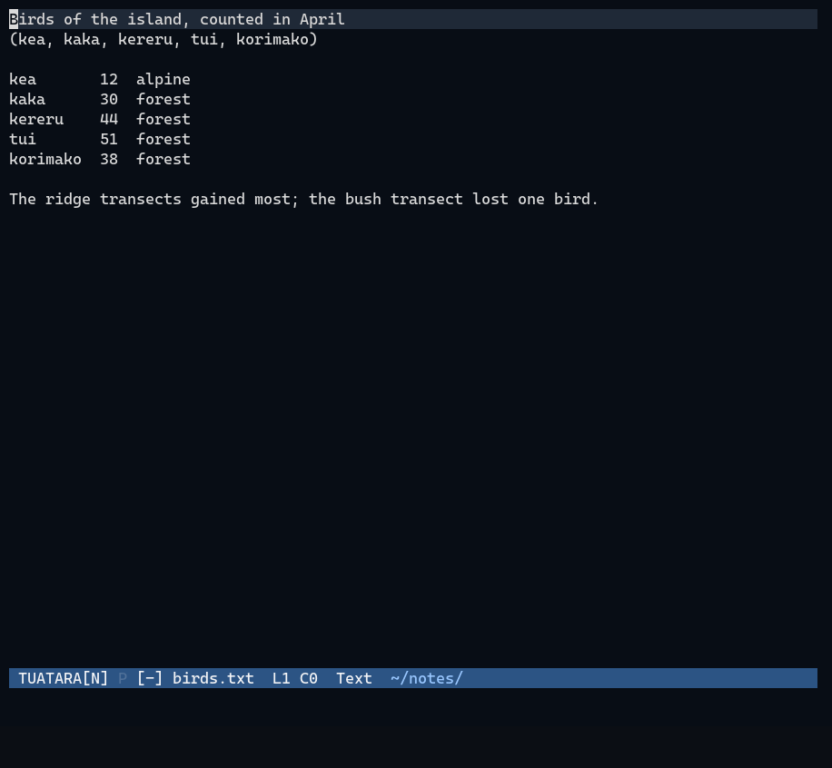

### Code

Colouring, indentation and selection by the syntax for close to 300
languages, by tree-sitter. Language servers start by themselves in folders
you trust: what a name is, its definition, renaming everywhere, completion,
and errors marked as you type; `C-c f` formats the buffer with the
language's own tool. Lisp runs in the editor itself, with a REPL and a
debugger.

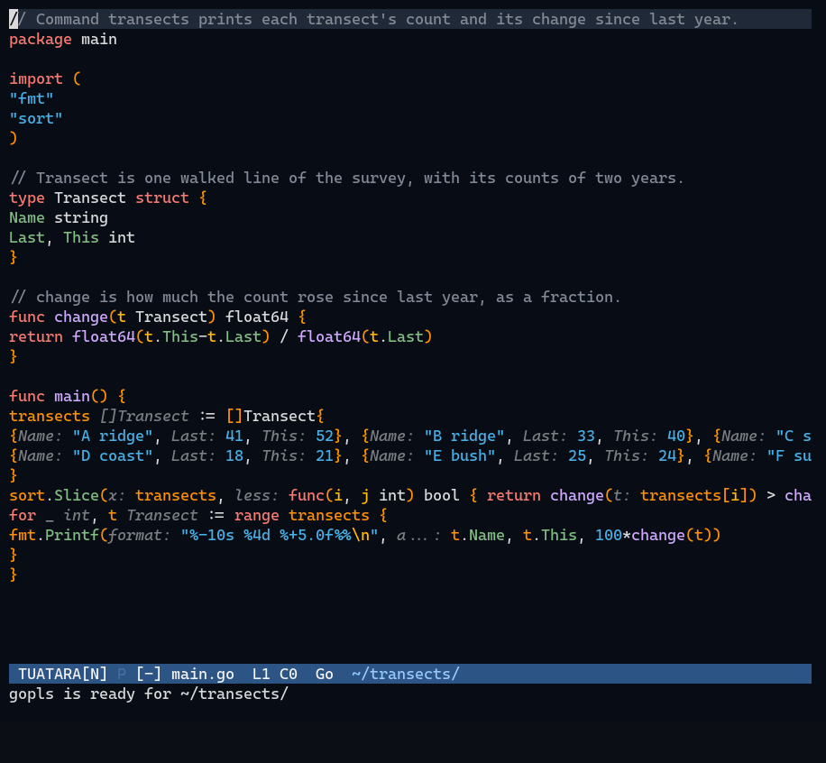

### Org

Org files read as Org itself reads them: folding, tables and their formulas,
checkboxes and their counts, tasks and their states, the agenda, capture,
clocking and tangling, and export to PDF (through LaTeX) and to Word.

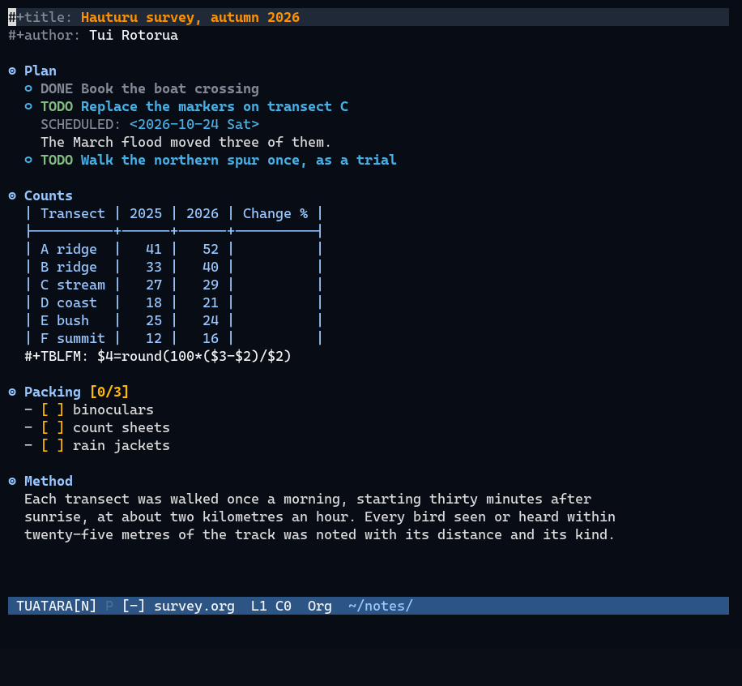

### Git

The state of a repository, after Magit: files untracked, changed and staged,
each change shown in hunks, and staged as a whole file, a hunk, or only the
lines you select, so a commit takes what belongs in it and leaves the rest.
Commits, the log, branches, rebasing and the rest from menus, and changes in
the gutter. Before git runs anything a repository names (its hooks and
filters), Tuatara asks once whether you trust it.

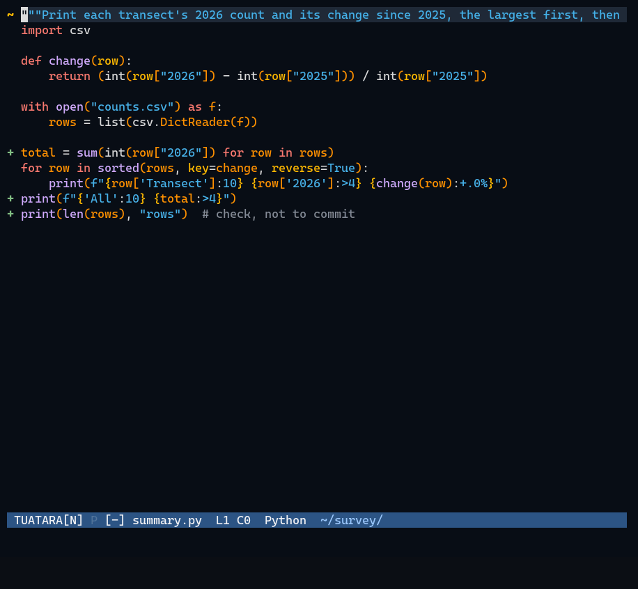

### Evidence stays evidence

For examining files that must stay untouched: `C-u C-x C-f` opens a file
safely, read-only, with nothing written beside it and its access time kept.
`M-x file-metadata` says what a file is and says of itself, read by Tuatara
alone: owner, times, SHA-256, a photo's EXIF and GPS position, a PDF's saves.

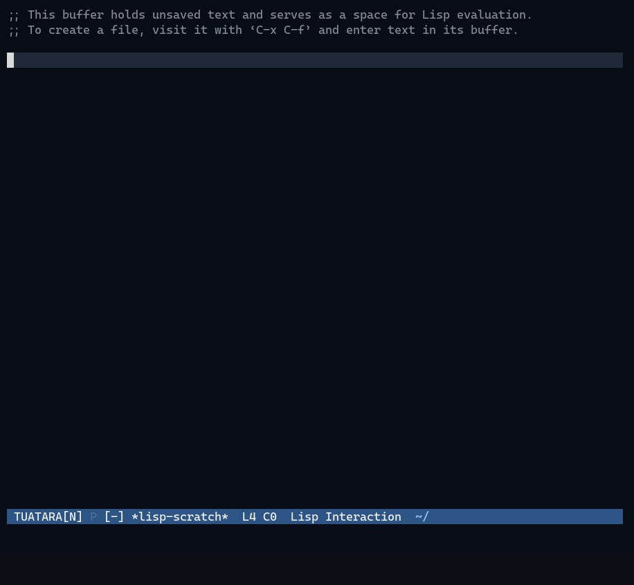

From the packages below, palimpsest takes a PDF apart into every save it
holds, and facematch ranks photos by the person they show.

<details>
<summary><b>More: history, documents, octets, a terminal</b></summary>

### History

`C-x G` shows a file as its latest commit left it, read only; `p` goes a
commit older and `n` newer, as Emacs's git-timemachine does. In rimu, the
directory editor, `G` puts each entry's last commit beside its name, and
`C-x G` lists the whole folder as a commit left it: files not yet written
are not there, and `RET` on one goes on through that file's history from
that commit. `C-x G` again is back to now.

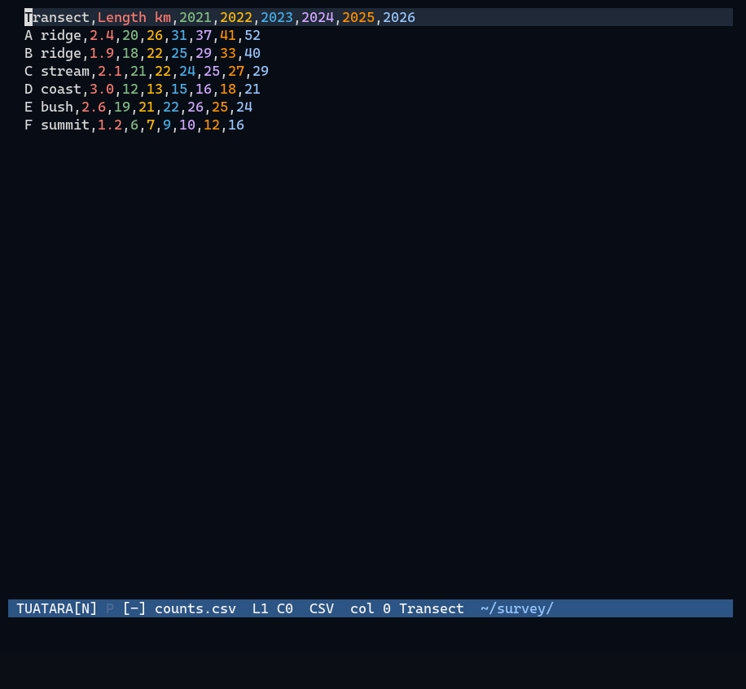

### Documents inside the editor

PDFs, pictures, and Word, Excel and PowerPoint files are shown in Tuatara's
own buffers, drawn by programs shut in a sandbox (no network, none of your
files). A PDF's pages can be shown dark, or as text to search and copy; a
Word document is also read as text by Tuatara itself. In rimu, the directory
editor, the file on the cursor's line is previewed beside the list.

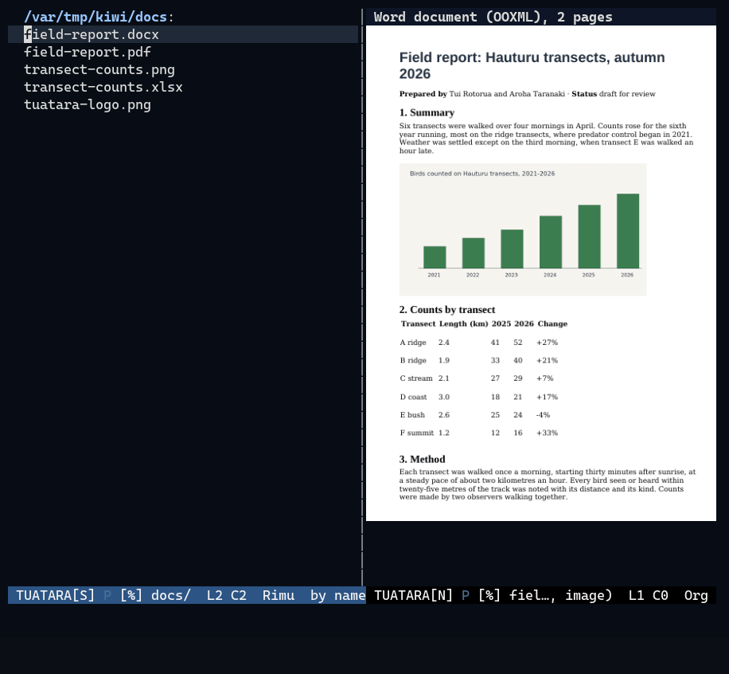

### Octets

Any file in hex, edited in place: the offsets, sixteen octets a row and the
text they make, the cursor shown on both sides. Typing writes over octets,
in hex or in the text column; `M-g g` goes to an offset, and octets are found
by their hex. A binary file opens in the hex view, safely, until you say it
may be written; a file of gigabytes shows at once.


### A terminal in a buffer

`M-x terminal` is a full terminal, on the library of Ghostty: colours, the
mouse, links, and pictures by kitty's graphics protocol. Its whole history is
kept as text, to search and copy like any buffer.

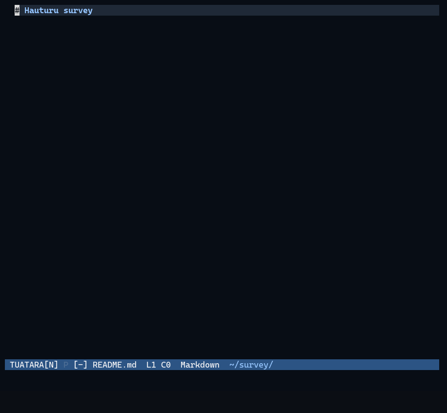

</details>

<details>
<summary><b>From the packages: palimpsest, facematch, outlook, csvdt</b></summary>

The packages load on asking, each for one job not everyone needs.

### palimpsest

palimpsest takes a PDF apart into every save it holds: what each save
changed, the text before and after, and every sign of editing examiners
know, each with its evidence. Every revision opens as a PDF of its own, and
`w` writes one out, with a log of how to find its signs again by hand.

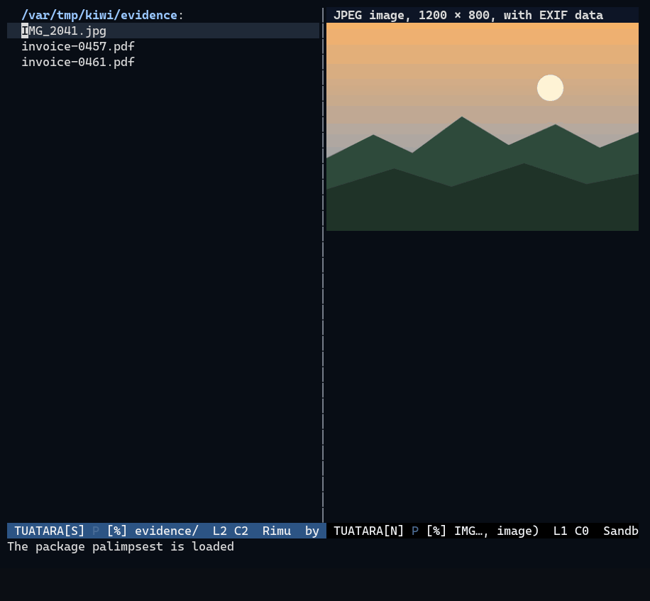

### facematch

facematch ranks photos by how probable it is that they show the person of
the reference photos, in the background and shut in the sandbox. Every face
in the film is generated; none is a real person.

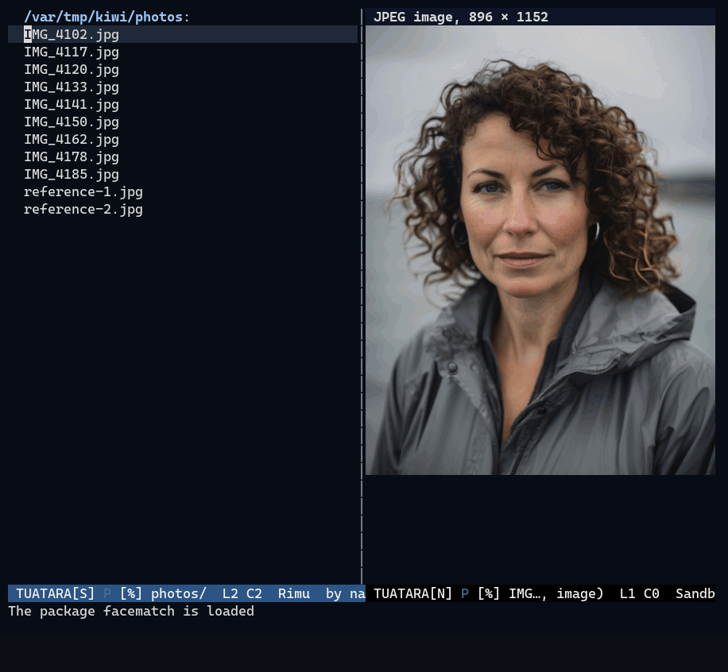

### outlook

outlook opens Outlook mailboxes (`.pst`, `.ost`) and messages (`.msg`,
`.eml`) read-only. A mailbox is read by readpst shut in the sandbox, its
messages listed by folder and narrowed as a regular expression is typed;
a message shows its headers as sent, its times in UTC too, and what it says
of itself, such as a Reply-To elsewhere. Attachments open from private
copies, and messages are copied out as saved mail or Outlook items. Every
name in the film is made up.

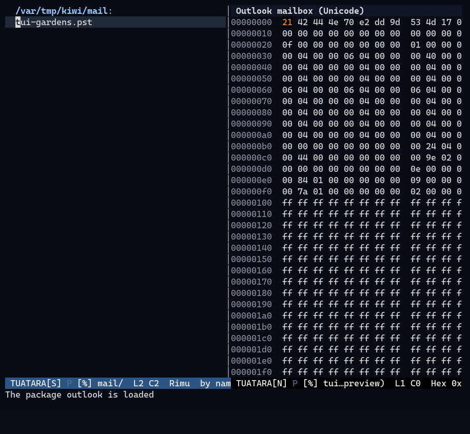

### csvdt

csvdt runs [csvdt](https://github.com/YardQuit/csvdt) over a CSV buffer, a
selection or banked lines, in the background, its output in a buffer of its
own: timestamps of any offset put in UTC, at an offset you name or in local
time, Unix times read as dates, and the time between events, exact in days,
hours, minutes and seconds. The timeline in the film is made up.

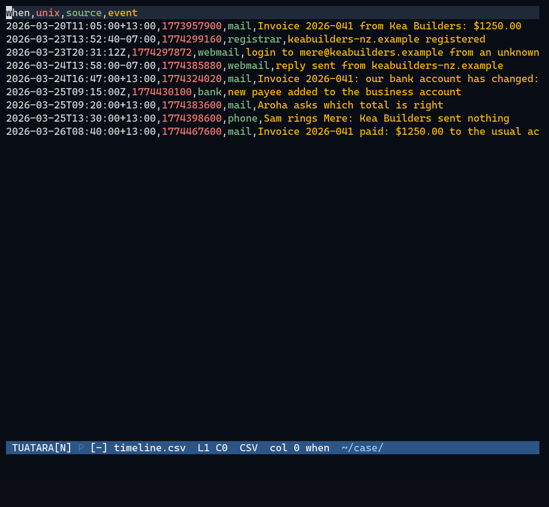

</details>

### Yours to change

Everything but a small core is ordinary Lisp, and the init file can redefine
any of it. Every command, variable and face has its help, and the source of
anything is one key away.

### The repositories

- [tuatara](https://github.com/Tuatara-Editor/tuatara): the editor
- [tuatara-packages](https://github.com/Tuatara-Editor/tuatara-packages):
  the project's own packages, loaded on asking, each for one job not
  everyone needs

Contributions to the editor come through pull requests from approved
contributors; see its `CONTRIBUTING.md`. The packages are written and kept by
the project: bug reports and ideas for them are welcome as issues. A package
of your own lives in a repository of your own, kept by you, and loads in
Tuatara from there like any other.
