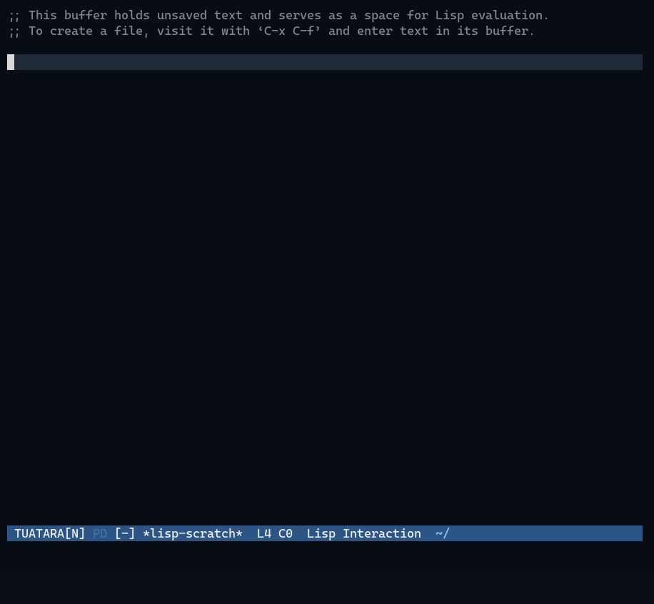
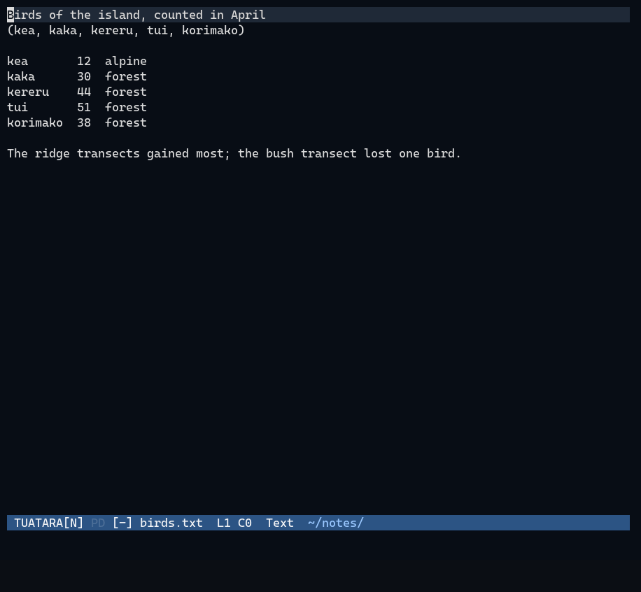
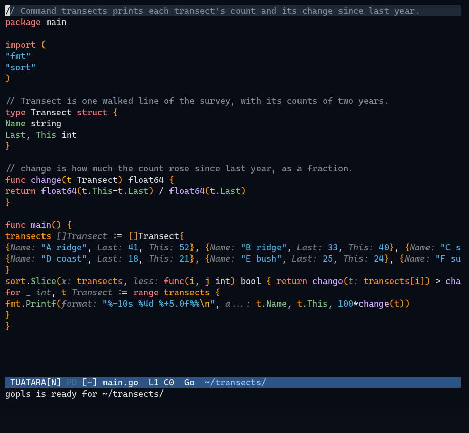
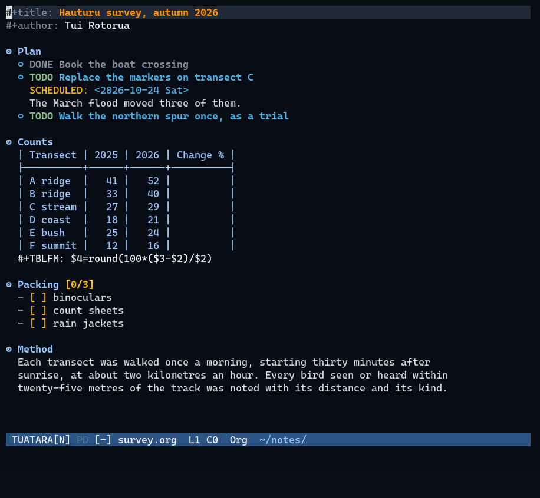
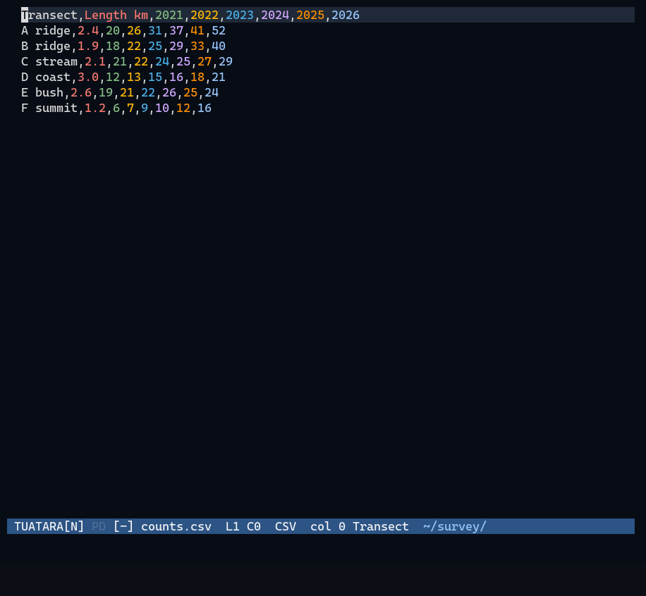
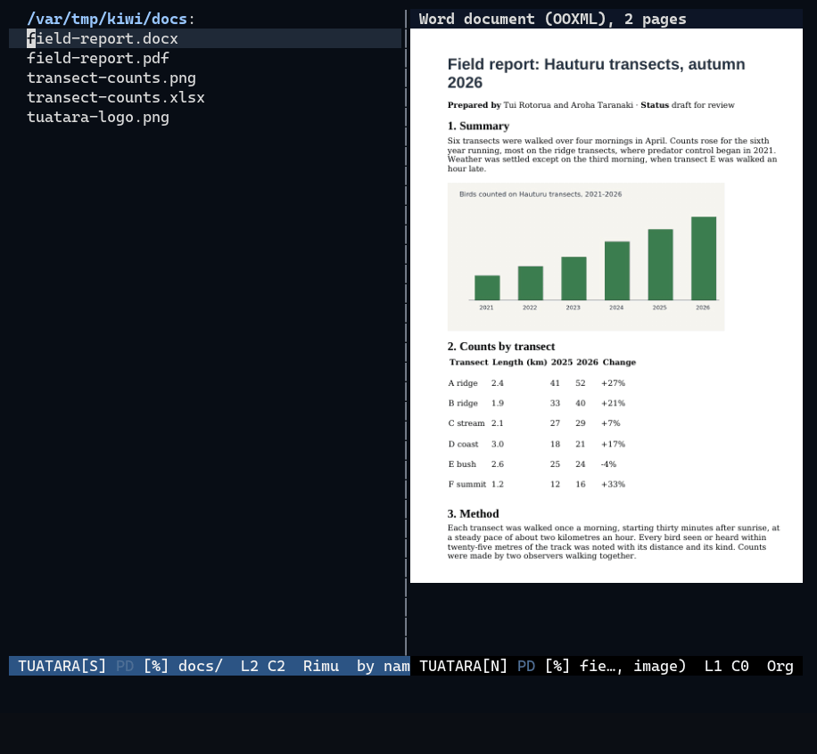
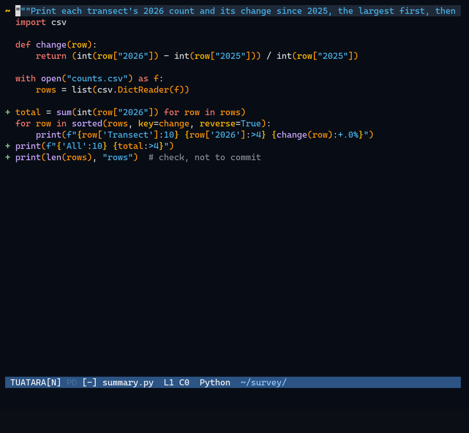

## Tuatara

A text editor for the terminal and the desktop, written in Common Lisp after
the ideas of Emacs, made to open files from anywhere safely.

**[Read the manual](https://tuatara-editor.github.io/tuatara/)**

| **Opens anything safely** | **Files of any size** | **Git, after Magit** |
|---|---|---|
| Nothing in a file is ever run; evidence opens read-only, its access time kept. | Gigabytes open at once; millions of cursors, saves in the background. | Stage the lines you select; a file or a folder as any commit left it. |
| **Org, its own** | **Code** | **Yours to change** |
| Folding, tables, agenda, capture, export to PDF and Word, no Emacs needed. | Close to 300 languages by tree-sitter, language servers, a Lisp REPL. | Everything but a small core is Lisp; the source of anything one key away. |

### Try it: pre-release testers welcome

From the newest [release](https://github.com/Tuatara-Editor/tuatara/releases),
download the file for your system and `SHA256SUMS` into `~/Downloads`, then:

```sh
cd ~/Downloads
sha256sum -c --ignore-missing SHA256SUMS                # says OK for your file
sudo dnf install ./tuatara-*.x86_64.rpm                 # Fedora 40 and newer
sudo apt install ./tuatara_*_amd64.deb                  # Ubuntu 24.04 and newer, Debian 13
sudo pacman -U tuatara-*-x86_64.pkg.tar.zst             # Arch and Omarchy
```

Then `tuatara` starts it in the terminal, `tuatara --gui` in a window of its
own, and it is among your applications (on Omarchy, `Super` + `Space`). On
anything else the AppImage runs with nothing installed:

```sh
chmod +x Tuatara-x86_64.AppImage
./Tuatara-x86_64.AppImage --gui FILE
```

The [tuatara README](https://github.com/Tuatara-Editor/tuatara#installing-it-step-by-step)
walks through it step by step.

It works on any file system, and best on one that shares blocks between
files (btrfs, XFS, bcachefs, ZFS): there a copy of a large file takes no time
and no space, and a save shares the blocks of what did not change wherever it
can. `M-x check-health` says which of the programs Tuatara can use are
installed; the [tuatara README](https://github.com/Tuatara-Editor/tuatara#readme)
says what to install beside it.

Something wrong, or an idea? [Open an
issue](https://github.com/Tuatara-Editor/tuatara/issues/new/choose): the
form asks for the version, the system, and the lines of
`~/.cache/tuatara/debug.log` from around the failure. Never attach a file you
are not free to share: a small made-up one that shows the same is enough.

### Files of any size

A file of gigabytes opens at once, its lines counted in the background on
every core. A regular expression is counted as you type; `f` puts a cursor on
every match, here 3,750,098 of them in a 2.1 GB file, and what is typed at
one is written at all, those out of sight in the background. The save runs in
the background too, the editor free meanwhile.

<picture>
  <source media="(prefers-color-scheme: light)" srcset="media/tuatara/big-file-light.gif">
  
</picture>

### Editing

DONKEY modal editing on top of the standard Emacs keys (or the Emacs keys
alone): in NORMAL state letters move and select, by word, line, bracket,
paragraph or the syntax. A selection splits into a cursor at every match of a
regular expression, each changed, wrapped or deleted at once; `t` adds a
cursor on the next line; one `u` undoes it all.

<picture>
  <source media="(prefers-color-scheme: light)" srcset="media/tuatara/editing-light.gif">
  
</picture>

### Code

Colouring, indentation and selection by the syntax for close to 300
languages, by tree-sitter. Language servers start by themselves in folders
you trust: what a name is, its definition, renaming everywhere, completion,
and errors marked as you type; `C-c f` formats the buffer with the
language's own tool. Lisp runs in the editor itself, with a REPL and a
debugger.

<picture>
  <source media="(prefers-color-scheme: light)" srcset="media/tuatara/code-light.gif">
  
</picture>

### Org

Org files read as Org itself reads them: folding, tables and their formulas,
checkboxes and their counts, tasks and their states, the agenda, capture,
clocking and tangling, and export to PDF (through LaTeX) and to Word.

<picture>
  <source media="(prefers-color-scheme: light)" srcset="media/tuatara/org-light.gif">
  
</picture>

### Git

The state of a repository, after Magit: files untracked, changed and staged,
each change shown in hunks, and staged as a whole file, a hunk, or only the
lines you select, so a commit takes what belongs in it and leaves the rest.
Commits, the log, branches, rebasing and the rest from menus, and changes in
the gutter. Before git runs anything a repository names (its hooks and
filters), Tuatara asks once whether you trust it.

<picture>
  <source media="(prefers-color-scheme: light)" srcset="media/tuatara/git-light.gif">
  
</picture>

### Evidence stays evidence

For examining files that must stay untouched: `C-u C-x C-f` opens a file
safely, read-only, with nothing written beside it and its access time kept.
`M-x file-metadata` says what a file is and says of itself, read by Tuatara
alone: owner, times, SHA-256, a photo's EXIF and GPS position, a PDF's saves.

<picture>
  <source media="(prefers-color-scheme: light)" srcset="media/tuatara/evidence-light.gif">
  
</picture>

From the packages below, palimpsest takes a PDF apart into every save it
holds, and facematch ranks photos by the person they show.

<details>
<summary><b>More: history, documents, octets, a terminal</b></summary>

### History

`C-x G` shows a file as its latest commit left it, read only; `p` goes a
commit older and `n` newer, as Emacs's git-timemachine does. In rimu, the
directory editor, `G` puts each entry's last commit beside its name, and
`C-x G` lists the whole folder as a commit left it: files not yet written
are not there, and `RET` on one goes on through that file's history from
that commit. `C-x G` again is back to now.

<picture>
  <source media="(prefers-color-scheme: light)" srcset="media/tuatara/history-light.gif">
  
</picture>

### Documents inside the editor

PDFs, pictures, and Word, Excel and PowerPoint files are shown in Tuatara's
own buffers, drawn by programs shut in a sandbox (no network, none of your
files). A PDF's pages can be shown dark, or as text to search and copy; a
Word document is also read as text by Tuatara itself. In rimu, the directory
editor, the file on the cursor's line is previewed beside the list.

<picture>
  <source media="(prefers-color-scheme: light)" srcset="media/tuatara/documents-light.gif">
  
</picture>

### Octets

Any file in hex, edited in place: the offsets, sixteen octets a row and the
text they make, the cursor shown on both sides. Typing writes over octets,
in hex or in the text column; `M-g g` goes to an offset, and octets are found
by their hex. A binary file opens in the hex view, safely, until you say it
may be written; a file of gigabytes shows at once.

<picture>
  <source media="(prefers-color-scheme: light)" srcset="media/tuatara/hex-light.gif">
  
</picture>

### A terminal in a buffer

`M-x terminal` is a full terminal, on the library of Ghostty: colours, the
mouse, links, and pictures by kitty's graphics protocol. Its whole history is
kept as text, to search and copy like any buffer.

<picture>
  <source media="(prefers-color-scheme: light)" srcset="media/tuatara/terminal-light.gif">
  
</picture>

</details>

### Yours to change

Everything but a small core is ordinary Lisp, and the init file can redefine
any of it. Every command, variable and face has its help, and the source of
anything is one key away.

The editor: [Repository](https://github.com/Tuatara-Editor/tuatara) · [Manual](https://tuatara-editor.github.io/tuatara/)

## The packages

The project's own packages, loaded on asking, each for one job not everyone needs, each in a repository of its own.

### kitty

`M-x kitty` opens windows of a kitty that Tuatara starts, brings their text into a buffer with its colours, and types into them.

[Repository](https://github.com/Tuatara-Editor/tuatara-kitty) · [Manual](https://tuatara-editor.github.io/tuatara-kitty/)

<picture>
  <source media="(prefers-color-scheme: light)" srcset="https://raw.githubusercontent.com/Tuatara-Editor/tuatara-kitty/main/media/kitty-light.gif">
  
</picture>

### outlook

For examining mail from evidence: Outlook items (.msg), saved mail (.eml) and mailboxes (.pst, .ost) opened as messages, read only, nothing in them run. It is no mail client and signs in to no account. A mailbox is read by the package itself, shut in the sandbox, its messages listed by folder and narrowed as a regular expression is typed. A message shows its headers as sent and its times in UTC too. Every name in the film is made up.

[Repository](https://github.com/Tuatara-Editor/tuatara-outlook) · [Manual](https://tuatara-editor.github.io/tuatara-outlook/)

<picture>
  <source media="(prefers-color-scheme: light)" srcset="https://raw.githubusercontent.com/Tuatara-Editor/tuatara-outlook/main/media/outlook-light.gif">
  
</picture>

### garamond

One space or two after a full stop, as the document itself says.

[Repository](https://github.com/Tuatara-Editor/tuatara-garamond) · [Manual](https://tuatara-editor.github.io/tuatara-garamond/)

<picture>
  <source media="(prefers-color-scheme: light)" srcset="https://raw.githubusercontent.com/Tuatara-Editor/tuatara-garamond/main/media/garamond-light.gif">
  
</picture>

### facematch

Candidate photos ranked by how probable it is that they show the person of one or more master photos. It runs in the background, shut in the sandbox. Every face in the film is generated; none is a real person.

[Repository](https://github.com/Tuatara-Editor/tuatara-facematch) · [Manual](https://tuatara-editor.github.io/tuatara-facematch/)

<picture>
  <source media="(prefers-color-scheme: light)" srcset="https://raw.githubusercontent.com/Tuatara-Editor/tuatara-facematch/main/media/facematch-light.gif">
  
</picture>

### palimpsest

A PDF taken apart into every save it holds, and searched for every sign of editing or forgery examiners know. It shows what each save changed, and `w` writes any revision out as a PDF of its own. It names the craft a change took, from a PDF editor's text tool to work in a scan's own pixels, and `d` frames what it found in red. It works on scans too, saved as a PDF or as a picture (PNG, JPEG, TIFF), where it reads the ink, edges and paper of each word.

[Repository](https://github.com/Tuatara-Editor/tuatara-palimpsest) · [Manual](https://tuatara-editor.github.io/tuatara-palimpsest/)

<picture>
  <source media="(prefers-color-scheme: light)" srcset="https://raw.githubusercontent.com/Tuatara-Editor/tuatara-palimpsest/main/media/palimpsest-light.gif">
  
</picture>

<picture>
  <source media="(prefers-color-scheme: light)" srcset="https://raw.githubusercontent.com/Tuatara-Editor/tuatara-palimpsest/main/media/palimpsest-craft-light.gif">
  
</picture>

### csv-columns

The columns of every record of a CSV or TSV file rearranged as awk's print does.

[Repository](https://github.com/Tuatara-Editor/tuatara-csv-columns) · [Manual](https://tuatara-editor.github.io/tuatara-csv-columns/)

<picture>
  <source media="(prefers-color-scheme: light)" srcset="https://raw.githubusercontent.com/Tuatara-Editor/tuatara-csv-columns/main/media/csv-columns-light.gif">
  
</picture>

### caldav

Your agenda shared with GNOME Calendar, Thunderbird and phones through a CalDAV server.

[Repository](https://github.com/Tuatara-Editor/tuatara-caldav) · [Manual](https://tuatara-editor.github.io/tuatara-caldav/)

<picture>
  <source media="(prefers-color-scheme: light)" srcset="https://raw.githubusercontent.com/Tuatara-Editor/tuatara-caldav/main/media/caldav-light.gif">
  
</picture>

### csvdt

[csvdt](https://github.com/YardQuit/csvdt), which converts the timestamps and durations of CSV records, run over a buffer, a selection or banked lines. Its output comes in a buffer of its own. The timeline in the film is made up.

[Repository](https://github.com/Tuatara-Editor/tuatara-csvdt) · [Manual](https://tuatara-editor.github.io/tuatara-csvdt/)

<picture>
  <source media="(prefers-color-scheme: light)" srcset="https://raw.githubusercontent.com/Tuatara-Editor/tuatara-csvdt/main/media/csvdt-light.gif">
  
</picture>

### themes

Popular colour themes, dark and light versions of palettes you may know from other editors (Catppuccin, Dracula, Nord, One Dark, Solarized, Tokyo Night), offered by `M-x load-theme`.

[Repository](https://github.com/Tuatara-Editor/tuatara-themes) · [Manual](https://tuatara-editor.github.io/tuatara-themes/)

<picture>
  <source media="(prefers-color-scheme: light)" srcset="https://raw.githubusercontent.com/Tuatara-Editor/tuatara-themes/main/media/themes-light.gif">
  
</picture>

### Loading a package

A package is loaded by a line in Tuatara's init file (`~/.config/tuatara/init.lisp`), its settings after `:config`, as its README shows:

```lisp
(load-package "garamond" :source "https://github.com/Tuatara-Editor/tuatara-garamond")
(load-package "outlook" :source "https://github.com/Tuatara-Editor/tuatara-outlook"
  :config
  (setf *outlook-include-deleted* nil))
```

At the next start Tuatara asks once whether to compile and load it (`v` shows its source first); `M-x check-health` then says whether the programs it uses are found. Each package's README says what it needs beside Tuatara and how to install it, also on a machine without internet.

Contributions to the editor come through pull requests from approved
contributors; see its `CONTRIBUTING.md`. The packages are written and kept by
the project: bug reports and ideas for them are welcome as issues. A package
of your own lives in a repository of your own, kept by you, and loads in
Tuatara from there like any other.
